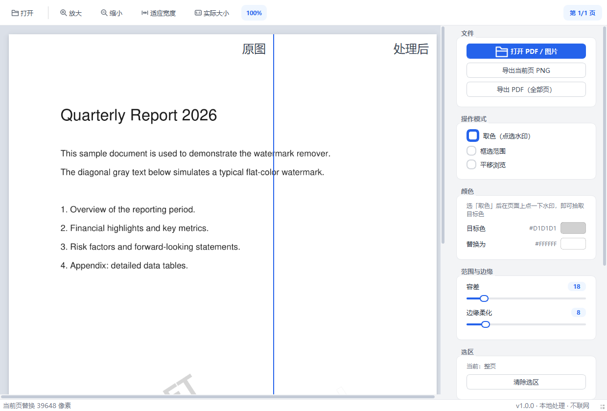

# Watermark Remover · 本地去水印工具

[](https://github.com/Li-Junze/watermark-remover/actions/workflows/ci.yml)
[](LICENSE)
[](https://www.python.org/)
[](https://www.riverbankcomputing.com/software/pyqt/)

一个**纯本地运行**的桌面去水印工具，针对**纯色水印**：在页面上点选水印颜色、
设定容差（颜色范围），即可把该范围内的像素统一替换为指定颜色（默认白色）。
支持 **PDF 与常见图片格式**，全部图像处理在本地完成，**不联网、不上传任何数据**。

<p align="center">
  
</p>

## ✨ 功能特性

- 🎨 **取色去水印**：点一下水印拾取目标色，拖动容差滑杆实时预览
- 📄 **多页 PDF 支持**：逐页处理，也可勾选「同步到所有页」一次套用
- ✂️ **框选范围**：只处理选区内，避免误伤正文
- 🌡️ **边缘柔化**：替换边缘软过渡，不留生硬色块
- 🔍 **前后对比**：拖动分割线直观查看处理前后差异
- 💾 **导出**：当前页 PNG / 全部页合成 PDF
- 🔒 **完全离线**：不联网、不采集数据，适合处理敏感文档
- ⌨️ **快捷键 + 拖拽**：文件直接拖进窗口即可打开

## 🚀 安装与运行

### 方式一：pip 安装（推荐）

```bash
git clone https://github.com/Li-Junze/watermark-remover.git
cd watermark-remover
pip install -r requirements.txt
```

```bash
python run.py                 # 启动
python run.py 文件.pdf        # 启动并直接打开文件
```

或安装为命令：

```bash
pip install .
watermark-remover             # 之后的任意目录都能启动
```

### 方式二：Windows 双击运行

1. 安装 [Python 3.9+](https://www.python.org/downloads/)（勾选 *Add to PATH*）
2. 双击仓库根目录的 `init_deps.bat`（首次装依赖）或手动 `pip install -r requirements.txt`
3. 双击 `run.bat` 启动

## 📖 使用流程

> 没有现成的水印文件？仓库里带了一个测试样例
> [`docs/sample-watermarked.pdf`](docs/sample-watermarked.pdf)，下载后即可体验。

1. **加载文件**：拖拽 / 点「打开」/ 命令行传参，三选一
2. **取色**：右侧「操作模式」保持 *取色*，在页面上点一下水印
3. **调容差**：加大容差直到水印消失、又不伤正文（白底文档变白即看不见）
4. 可选：切 *框选范围* 拖出矩形只处理框内；切 *对比* 拖动分割线看前后差异
5. **导出**：当前页 PNG，或全部页按相同规则合成 PDF

### 快捷键

| 快捷键 | 功能 |
| --- | --- |
| `Ctrl + O` | 打开文件 |
| `Ctrl + 滚轮` | 自由缩放 |
| `Ctrl + =` / `Ctrl + -` | 放大 / 缩小 |
| `Ctrl + 0` | 适应宽度 |
| `Ctrl + 1` | 实际大小 |

## 🧠 工作原理

对每个像素计算与目标水印色的最大通道差 `max(|ΔR|, |ΔG|, |ΔB|)`，
差值 ≤ 容差即判定为水印并替换为填充色；「边缘柔化」在容差带边缘做线性
软过渡，避免生硬锯齿。PDF 由 PyMuPDF 渲染为位图处理后重新合成导出。

## 📁 项目结构

```
watermark-remover/
├── run.py / run.bat          # 启动器（脚本 / Windows 双击）
├── requirements.txt
├── pyproject.toml            # 打包元数据（pip install . 可用）
├── src/watermark_remover/
│   ├── app.py                # 主窗口：工具栏 + 滚动阅读区 + 信号联动 + 导出
│   ├── core/                 # 纯逻辑层（无界面依赖）
│   │   ├── watermark.py      # 去水印核心算法（颜色范围替换，纯 numpy）
│   │   ├── document.py       # 文档加载(多页) / 处理 / 导出 PDF
│   │   └── imageutil.py      # QImage <-> numpy 互转
│   └── ui/
│       ├── theme.py          # 全局配色 + QSS 主题
│       ├── icons.py          # 程序化绘制的矢量图标
│       ├── page_view.py      # 单页画布：缩放 / 取色 / 框选 / 前后对比
│       └── control_panel.py  # 右侧卡片式参数面板
└── tests/test_watermark.py   # 核心算法单元测试
```

## ⚠️ 适用范围与限制

- 水印为**纯色**时效果最佳；图片 / 半透明 logo 类水印用颜色法无法去除
- 容差过大可能误伤与水印颜色接近的正文，请配合预览与框选使用
- 导出 PDF 为位图合成，文件体积与扫描件相当

## 🤝 贡献

欢迎 Issue 与 PR！开发调试：

```bash
python run.py
python tests/test_watermark.py
```

## 📄 许可证

[MIT](LICENSE) © 2026 Li-Junze

---

English documentation: [README.en.md](README.en.md)
